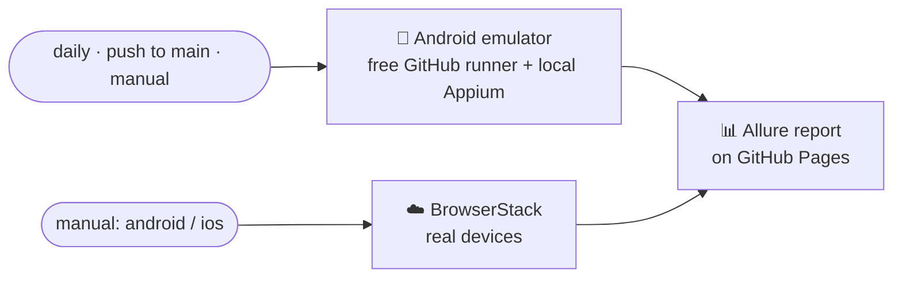

<div align="center">

# 📱 Mobile Automation Framework

**One test suite for Android and iOS, built with WebdriverIO, Appium, TypeScript and Allure**


</div>

---

## ✨ Highlights

- 🤖🍏 **One codebase for both platforms.** Each element gets one locator per platform, declared once, so specs never check which platform they're on.
- 🧱 **Page Object Model.** `BasePage` holds the shared waits, actions and assertions. Each screen has its own small page class.
- ✅ **Assertion-heavy tests.** Each step checks the screen before acting, checks the result after, and checks that nothing unexpected appears.
- 📊 **Allure report.** Shows each test step by step, with a screenshot and a screen recording of every test.
- 🔁 **GitHub Actions CI.** Runs on an Android emulator on GitHub's free runner, plus an on-demand BrowserStack run on real devices.
- ☁️ **BrowserStack ready.** Switching from a local device to a BrowserStack real device takes one environment variable.

---

## 🗂️ Project structure

```
├── .github/workflows/
│   ├── emulator.yml            # CI: Android emulator on the free GitHub runner
│   └── browserstack.yml        # CI: real devices on BrowserStack (manual run)
├── tests/
│   ├── apps/                   # App builds under test (.apk / .app)
│   ├── config/                 # Appium capabilities: local + BrowserStack, Android + iOS
│   ├── data/                   # Test data and expected messages
│   ├── factories/              # selector(android, ios): one locator per platform
│   ├── pages/                  # Page Objects (BasePage + LoginPage)
│   ├── specs/login/            # Test specs
│   └── utils/                  # step() for Allure, timeouts, logger
├── wdio.conf.ts                # WebdriverIO config: platform switch, reporting, hooks
└── package.json
```

---

## 🧪 Tests

The tests run against the open-source [WebdriverIO demo app](https://github.com/webdriverio/native-demo-app), which has the same screens on Android and iOS.

| Spec | What it checks |
|---|---|
| `test_validate_successful_login_flow` | The login form renders correctly. Valid credentials log in, no validation errors appear, and the success alert shows the right title and message, then closes. |
| `test_validate_email_format_validation` | Four malformed emails (missing `@`, domain, username or TLD) are each rejected with only the email error and no alert. A corrected email then logs in. |
| `test_validate_password_length_validation` | An empty form shows both errors. A 7-character password is rejected and an 8-character password is accepted. |

---

## ⚙️ Setup

**Prerequisites:** Node.js 20+, Java 17+ (for Allure), Android Studio with an emulator, and Xcode with an iOS simulator (macOS only).

```bash
# 1. Install everything (WebdriverIO, Appium 3 and both Appium drivers)
npm install

# 2. Download the demo app builds into tests/apps
mkdir -p tests/apps && cd tests/apps
curl -fLO https://github.com/webdriverio/native-demo-app/releases/download/v2.0.0/android.wdio.native.app.v2.0.0.apk
mv android.wdio.native.app.v2.0.0.apk wdio-demo.apk
curl -fLO https://github.com/webdriverio/native-demo-app/releases/download/v2.0.0/ios.simulator.wdio.native.app.v2.0.0.zip
unzip -q ios.simulator.wdio.native.app.v2.0.0.zip && mv wdiodemoapp.app wdio-demo.app && rm *.zip
cd ../..
```

---

## ▶️ Running the tests

**Terminal 1: start a device and Appium**

```bash
emulator -avd <your_avd_name>     # Android (list your AVDs with: emulator -list-avds)
xcrun simctl boot "iPhone 16"     # iOS

npm run appium
```

**Terminal 2: run the tests**

```bash
npm run test:android      # all tests on Android
npm run test:ios          # all tests on iOS

# a single spec
npx cross-env PLATFORM=android wdio run wdio.conf.ts --spec tests/specs/login/test_validate_successful_login_flow.ts
```

**Run on a specific device**

```bash
# Android: any emulator or real phone. Get the serial from `adb devices`
ANDROID_UDID=emulator-5554 npm run test:android

# iOS: pick a simulator by name and iOS version
IOS_DEVICE_NAME="iPhone 16 Pro" IOS_PLATFORM_VERSION=18.4 npm run test:ios

# iOS: or by UDID. Get it from `xcrun simctl list devices booted`
IOS_UDID=<simulator-udid> npm run test:ios
```

If no device is pinned, Android uses the first connected device and iOS uses an iPhone 16 on iOS 18.4.

**Open the report for the latest run**

```bash
npm run report
```

Each run clears `allure-results/` first, so the report only ever shows the latest run. Every test has a screenshot and a screen recording attached.

| Command | Description |
|---|---|
| `npm run appium` | Starts the Appium server on port 4723 |
| `npm run test:android` | Runs the suite on Android |
| `npm run test:ios` | Runs the suite on iOS |
| `npm run test:android:bs` | Runs the suite on a BrowserStack Android device |
| `npm run test:ios:bs` | Runs the suite on a BrowserStack iOS device |
| `npm run report` | Opens the Allure report for the latest run |
| `npm run typecheck` | Type-checks the project |

---

## 🧱 Page Object approach

### What it is

Page Object Model (POM) means **every screen of the app gets one class**. The class knows two things about its screen:

1. **Where things are**: the locators for its buttons, inputs and texts.
2. **What you can do there**: actions such as `login()`, and checks such as `validateLoginFormIsVisible()`.

The tests never touch locators directly. They only call page methods, so a test reads like the steps a manual tester would follow.

```
 Spec (what to test)  ──▶  LoginPage (what the screen offers)  ──▶  BasePage (how to click, type, wait, assert)
```

### The building blocks

| Piece | File | What it does |
|---|---|---|
| `selector(android, ios, name)` | `factories/page.factory.ts` | Holds an element's **two locators**, one for Android and one for iOS, plus a readable name used in logs and reports. The element is declared once and works on both platforms. |
| `textSelector(text)` | `factories/page.factory.ts` | Builds a selector for an element that has no id and can only be found by its visible text. |
| `getPlatform()` | `factories/selector.factory.ts` | Asks the running session which platform it is on (`android` or `ios`). |
| `resolveLocator(selector, platform)` | `factories/page.factory.ts` | Picks the right locator out of the pair for the current platform. |
| `resolve(selector)` | `pages/base.page.ts` | Combines the two above: finds the element on the device using the right locator. |
| `BasePage` | `pages/base.page.ts` | The parent of every page. It holds the shared actions (`click`, `type`, `hideKeyboard`), the smart waits (`waitUntilVisibleWithRetry`), and the assertions (`assertElementDisplayed`, `assertTextEquals`, `assertAlert`, ...). |
| `LoginPage` | `pages/login.page.ts` | One screen: its elements plus its flows (`openLoginTab`, `login`, `validateLoginFormIsVisible`). |
| `step()` | `utils/helpers.ts` | Wraps a block of a test as a named step in the Allure report. |

### How one click flows through it

```ts
await loginPage.click(loginPage.loginButton);
```

1. `loginButton` is `selector("~button-LOGIN", "~button-LOGIN", "LOGIN button")`.
2. `click()` (from `BasePage`) waits until the button is visible, retrying instead of failing on the first slow frame.
3. `resolve()` asks `getPlatform()` which device this is, and `resolveLocator()` picks the Android or the iOS locator.
4. The element is found and clicked. The log and the report say **"LOGIN button"** instead of a raw locator.

### Example

**Page:** elements are declared once, and flows are built from `BasePage` actions:

```ts
export class LoginPage extends BasePage {
  public email = selector("~input-email", "~input-email", "Email input");
  public password = selector("~input-password", "~input-password", "Password input");
  public loginButton = selector("~button-LOGIN", "~button-LOGIN", "LOGIN button");

  async login(email: string, password: string) {
    await this.addEmail(email);
    await this.addPassword(password);
    await this.hideKeyboard();
    await this.click(this.loginButton);
  }
}
```

**Spec:** named steps, with assertions in every step:

```ts
await step("Verify success alert title and message", async () => {
  await loginPage.assertAlert(LoginData.successAlertTitle, LoginData.successAlertMessage);
});
```

### Why it pays off

- **One test, two platforms.** Specs never check `if (android)`. The selector pair handles the platform difference in one place.
- **One change, one place.** If the app renames the LOGIN button, only `login.page.ts` changes. Every test using it keeps working.
- **Readable tests.** `loginPage.login(email, password)` says what happens. A non-developer can read the spec.
- **Reuse.** Waits, retries, iOS password-field handling and assertions are written once in `BasePage`, and every page inherits them.
- **Less flakiness.** Every action waits for its element through one retry mechanism instead of hard-coded sleeps.
- **Clear failures.** Errors and report steps use readable names ("LOGIN button"), so a failure says which element and which step broke.
- **Easy to grow.** A new screen means one new page class that extends `BasePage`, and it gets all the shared behaviour for free.

---

## 🔁 CI/CD

Two GitHub Actions workflows, like a real project setup:



| Workflow | When it runs | What it does |
|---|---|---|
| `emulator.yml` | Daily at 02:00 PKT, on push to `main`, and manually | Boots an Android emulator on the free `ubuntu-latest` runner (KVM accelerated), starts Appium, runs the suite, and publishes the Allure report to GitHub Pages. Costs only runner minutes, with no device-cloud cost. Manual runs can pick the API level and the specs to run. |
| `browserstack.yml` | Manually, choosing `android` or `ios` | Uploads the app to BrowserStack, runs the suite on a real device, marks each BrowserStack session passed or failed, and publishes the Allure report. Session videos and logs are on the BrowserStack dashboard. |

Both workflows add a pass/fail table to the run summary and fail the run when a test fails.

**One-time setup**

- *Settings → Pages → Source:* **GitHub Actions**
- *Settings → Secrets → Actions:* `BROWSERSTACK_USERNAME`, `BROWSERSTACK_ACCESS_KEY`
- For iOS on BrowserStack: a repository variable `IOS_IPA_URL` with a link to a signed real-device `.ipa`. The public demo app only ships a simulator build.

---

## ☁️ BrowserStack

The same tests run on BrowserStack real devices with no code changes. `ENV=browserstack` switches the server to BrowserStack's hub and the capabilities to `tests/config/browserstack.*.capabilities.ts`.

```bash
# 1. Upload the app once and copy the "app_url" (bs://...) from the response
curl -u "$BROWSERSTACK_USERNAME:$BROWSERSTACK_ACCESS_KEY" \
  -X POST "https://api-cloud.browserstack.com/app-automate/upload" \
  -F "file=@tests/apps/wdio-demo.apk"

# 2. Run
export BROWSERSTACK_USERNAME=<username> BROWSERSTACK_ACCESS_KEY=<access_key>
BROWSERSTACK_APP_ID=bs://<app_id> npm run test:android:bs
BROWSERSTACK_APP_ID=bs://<app_id> npm run test:ios:bs
```

---

## 📊 Report

The Allure report includes:

- Android and iOS results, grouped by platform
- Every test broken down step by step
- A screenshot and a screen recording for every test (local runs; BrowserStack keeps its own recordings)
- Feature, story and severity labels
